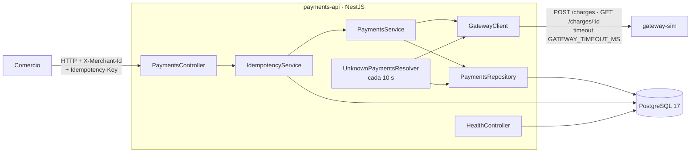
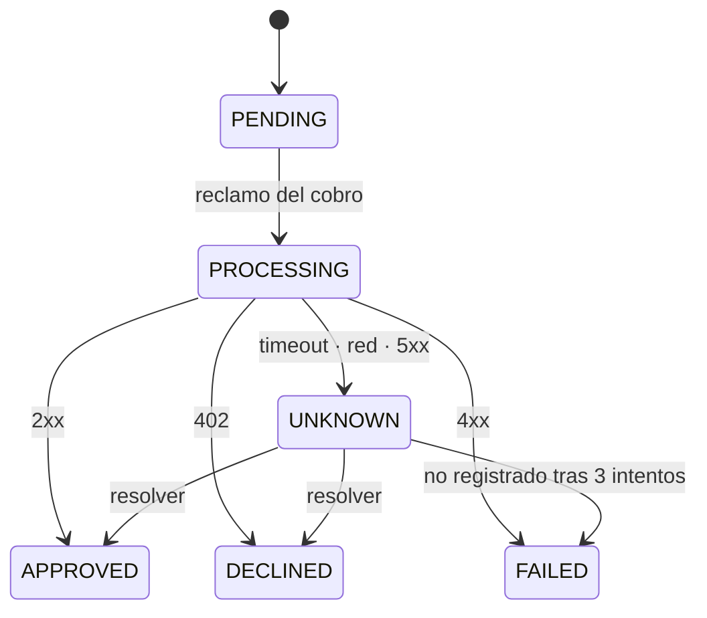
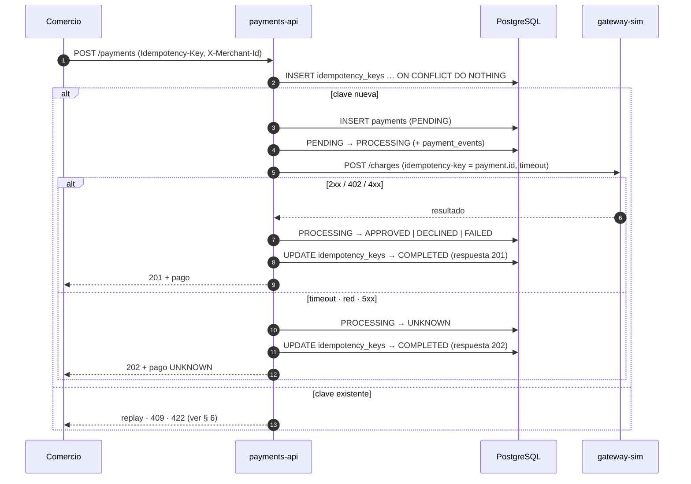

# Diseño · Fase 1 · Núcleo de pagos

Requisitos: [`requirements.md`](requirements.md) (R1–R10) · Contrato: [`apps/payments-api/docs/openapi.yaml`](../../apps/payments-api/docs/openapi.yaml)

---

## 1. Contexto y alcance

PagoLab simula el núcleo de un procesador de pagos: recibe órdenes de cobro de los comercios, las cobra en una pasarela externa y mantiene el estado de cada pago de forma consistente.

El dominio impone tres condiciones que guían todo el diseño:

1. **Un pago nunca se cobra dos veces**, aunque el cliente reintente la petición o dos procesos compitan por el mismo pago.
2. **Ante la duda, no se miente:** si la pasarela no responde, el sistema no sabe si cobró y lo declara `UNKNOWN`, nunca `FAILED`.
3. **Todo estado incierto se resuelve solo,** sin intervención manual, aunque haya varias réplicas corriendo.

**Dentro del alcance:** creación y cobro de pagos, idempotencia, máquina de estados auditable, resolución de estados desconocidos, consulta y listado paginado, operación (health, apagado ordenado), pruebas y contenedores.

**Fuera del alcance:** autenticación real (Fase 3), publicación de eventos y notificación a comercios (Fase 2), reembolsos y conciliación.

---

## 2. Arquitectura

| Componente | Responsabilidad |
|---|---|
| `PaymentsController` | Valida cabeceras y cuerpo, delega en idempotencia y fija el código HTTP (`201`/`202`) y las cabeceras `Location` e `Idempotent-Replayed` |
| `IdempotencyService` | Reclama la clave, ejecuta el caso de uso una sola vez y guarda la respuesta para repetirla |
| `PaymentsService` | Caso de uso de cobro: inserta, reclama (`PENDING → PROCESSING`), cobra y registra el resultado; consulta y lista |
| `PaymentsRepository` | SQL explícito: inserción, transición condicional con auditoría, reclamo de lotes para el resolver y listado por cursor |
| `GatewayClient` | Traduce las respuestas de la pasarela a un resultado de dominio y aplica el timeout |
| `UnknownPaymentsResolver` | Tarea periódica que lleva a estado final los pagos `UNKNOWN` y los `PROCESSING` atascados |
| `HealthController` | Liveness, readiness y la marca de apagado |
| `ProblemDetailsFilter` | Convierte toda excepción en una respuesta RFC 9457 sin filtrar detalles internos |

**Comunicación:** HTTP síncrono entre el comercio y la API y entre la API y la pasarela. PostgreSQL es la única fuente de verdad del estado; la API no guarda estado en memoria, por lo que puede ejecutarse en varias réplicas.

---

## 3. Modelo de datos

### Tablas

| Tabla | Propósito | Columnas relevantes |
|---|---|---|
| `payments` | Estado actual de cada pago | `id uuid PK`, `merchant_id`, `amount_cents bigint CHECK > 0`, `currency char(3)`, `status` (con `CHECK` de los 6 estados), `gateway_ref`, `attempts`, `next_check_at`, `created_at`, `updated_at` |
| `payment_events` | Auditoría inmutable de cada transición | `id bigint identity`, `payment_id FK`, `from_status`, `to_status`, `reason`, `created_at` |
| `idempotency_keys` | Estado y respuesta de cada clave | PK (`merchant_id`, `key`), `request_hash`, `status` (`IN_PROGRESS`/`COMPLETED`), `response_code`, `response_body jsonb`, `expires_at` (24 h) |

- **`amount_cents bigint`:** los montos se guardan en la unidad mínima, como enteros, para evitar errores de redondeo de los decimales binarios. El driver devuelve `bigint` como texto y `toPayment` lo convierte con `Number`, lo cual es seguro porque el máximo permitido (10⁹) está muy por debajo de 2⁵³.
- **Restricciones en la base de datos** (`CHECK` de estado y monto, PK compuesta de idempotencia): son la última barrera si la aplicación tiene un error.

### Índices y por qué

| Índice | Definición | Consulta que sirve |
|---|---|---|
| `payments_pkey` | `(id)` | `GET /payments/{id}` y transiciones por id |
| `idempotency_keys_pkey` | `(merchant_id, key)` | Reclamo atómico de la clave: el `ON CONFLICT` se apoya en esta PK |
| `idx_payment_events_payment` | `(payment_id, created_at)` | Historial de un pago en orden cronológico |
| `idx_payments_to_resolve` | `(updated_at) WHERE status IN ('UNKNOWN','PROCESSING')` | Lote del resolver. Es **parcial**: indexa solo los pocos pagos pendientes, no los millones ya finalizados, así que se mantiene pequeño y barato de actualizar |
| `idx_payments_merchant_created` | `(merchant_id, created_at DESC, id DESC)` | Listado por cursor. Entrega las filas de un comercio ya ordenadas, así que Postgres lee solo las del `LIMIT`. Se creó con `CONCURRENTLY` para no bloquear escrituras |

Resultado medido con 1.000.000 de pagos (T12): **149,9 ms** con `Parallel Seq Scan` + ordenamiento sin el índice, frente a **1,2 ms** con `Index Scan` y 23 bloques leídos con él.

---

## 4. Máquina de estados

- Las transiciones válidas están declaradas en una tabla (`TRANSITIONS` en `payment-status.ts`); `canTransition` y `isFinal` se derivan de ella. `APPROVED`, `DECLINED` y `FAILED` son finales.
- **Transición condicional:** `UPDATE payments SET status = $to … WHERE id = $id AND status = $from`. Si otro proceso ya movió el pago, el `UPDATE` afecta 0 filas y la transición devuelve `null` en lugar de sobrescribir. Este es el mecanismo que impide que dos procesos cobren o resuelvan el mismo pago.
- Cada transición exitosa inserta su fila en `payment_events` **en la misma transacción** (`withTransaction`): no puede existir un cambio de estado sin su registro de auditoría.

---

## 5. Flujo de cobro

**El id del pago viaja como clave de idempotencia hacia la pasarela.** Si el cobro se reintentara con el mismo pago, la pasarela devolvería el cobro existente en lugar de crear otro. La misma referencia permite al resolver consultar el cobro después (`GET /charges/:id`).

---

## 6. Idempotencia

### Algoritmo

1. Calcular `request_hash = sha256(JSON del cuerpo)`.
2. **Reclamo atómico:** `INSERT INTO idempotency_keys … ON CONFLICT (merchant_id, key) DO NOTHING RETURNING key`. Nunca `SELECT` y luego `INSERT`: entre ambos, dos peticiones simultáneas podrían ver la clave libre y cobrar dos veces.
3. Si el reclamo tuvo éxito, ejecutar el caso de uso y guardar `response_code` y `response_body` con `status = COMPLETED`.
4. Si el caso de uso lanza una excepción, **borrar la clave** para permitir el reintento. Es seguro porque los fallos de la pasarela no lanzan excepción: se registran como `UNKNOWN` o `FAILED`. Por lo tanto, una excepción significa que el dinero no se movió.
5. Si el reclamo falló (la clave ya existía), decidir con la fila existente.

### Casos

| Situación | Respuesta |
|---|---|
| Clave nueva | Se procesa: `201` (estado final) o `202` (`UNKNOWN`) |
| Clave `COMPLETED`, mismo cuerpo | Respuesta original, con `Idempotent-Replayed: true`, sin volver a cobrar |
| Clave existente, cuerpo distinto | `422` |
| Clave expirada (más de 24 h) | `422`: el cliente debe usar una clave nueva |
| Clave `IN_PROGRESS` | `409`: la petición original sigue en curso |
| Misma clave, otro comercio | Independiente: la PK incluye `merchant_id` |
| Falta la clave o no es UUID | `400` |

---

## 7. Manejo de errores y timeouts

### Respuestas de la pasarela

| Respuesta de `gateway-sim` | Resultado | ¿Hay certeza sobre el cobro? |
|---|---|---|
| `2xx` | `APPROVED` | Sí, cobró |
| `402` | `DECLINED` (con motivo) | Sí, no cobró |
| Otro `4xx` | `FAILED` | Sí, rechazó la petición sin cobrar |
| `5xx` | `UNKNOWN` | No |
| Timeout (`AbortSignal.timeout(GATEWAY_TIMEOUT_MS)`) o error de red | `UNKNOWN` | **No: la pasarela pudo haber cobrado y responder tarde** |

Un timeout **nunca** se traduce en `FAILED` (R6). Declarar fallido un cobro que sí ocurrió llevaría al comercio a reintentar y cobrar dos veces.

### Resolución de desconocidos

Cada 10 segundos, `UnknownPaymentsResolver`:

1. **Reclama un lote** en una sola sentencia corta:
   - selecciona los `UNKNOWN` y los `PROCESSING` sin cambios en más de 2 minutos, con `FOR UPDATE SKIP LOCKED`;
   - les asigna un *lease* (`next_check_at = now() + 30 s`) e incrementa `attempts`.
2. **Fuera de cualquier transacción**, consulta a la pasarela cada pago del lote:
   - `PROCESSING` atascado → primero pasa a `UNKNOWN` (el proceso que lo cobraba murió);
   - cobro encontrado → `APPROVED` o `DECLINED`;
   - no encontrado → sigue `UNKNOWN` hasta el 3.er intento, y luego `FAILED`, porque la pasarela pudo registrarlo con retraso;
   - error de consulta → queda para el siguiente ciclo.

**Garantías con varias réplicas** (R7):
- `SKIP LOCKED` hace que cada réplica tome filas distintas sin esperarse.
- El *lease* impide que otra réplica tome el mismo pago durante 30 s después del reclamo.
- La transición condicional es la última barrera.
- Dentro de una réplica, la bandera `running` evita que dos ciclos se solapen.

### Errores HTTP

Todas las excepciones pasan por `ProblemDetailsFilter` y se responden como `application/problem+json` (RFC 9457) con `type`, `title`, `status`, `detail` e `instance`. Los errores `5xx` se registran completos en el log y al cliente solo se le responde `"Error interno"`, sin trazas ni mensajes internos.

### Apagado ordenado

Al recibir `SIGTERM` (`enableShutdownHooks`):
1. `beforeApplicationShutdown`: readiness pasa a `503` y el balanceador deja de enviar tráfico.
2. Nest termina las peticiones en curso.
3. `onApplicationShutdown`: se cierra el pool de PostgreSQL.

---

## 8. Estrategia de pruebas

| Nivel | Herramienta | Qué cubre |
|---|---|---|
| Unitarias | Vitest | Máquina de estados, `GatewayClient` (`201`/`402`/`4xx`/`5xx`/timeout con `fetch` simulado), ciclo del resolver (desactivado, sin solapamiento, errores), `withTransaction` (`COMMIT`/`ROLLBACK`) |
| Integración (e2e) | Vitest + Supertest + **Testcontainers** | La aplicación completa contra un PostgreSQL 17 efímero con las migraciones reales y una **pasarela falsa determinista**. Pruebas organizadas por requisito R1–R9 |

**Decisiones**

- **Base de datos real, no simulada:** lo que se prueba (`ON CONFLICT`, `SKIP LOCKED`, transacciones, índices) es comportamiento de PostgreSQL; un mock no lo reproduciría.
- **Pasarela falsa en proceso:** cada prueba decide la respuesta (aprobar, rechazar, `503`, `400`, lenta, colgada) y puede contar los cobros. Así se verifica que un replay no vuelve a cobrar.
- **Pruebas de concurrencia:** dos reclamos simultáneos nunca toman el mismo pago, y dos resolvers en paralelo resuelven cada pago una sola vez.
- **Casos límite de la paginación:** se recorren todas las páginas siguiendo `nextCursor`, con empates de `created_at` y con pagos creados en el mismo milisegundo. Este último caso detectó un error real de precisión en el cursor, que se corrigió.
- **Cobertura honesta:** se mide sobre todo `src/` con un umbral del 85 % de líneas que hace fallar la ejecución (R10). Estado final: 77 pruebas, 98,4 % de líneas.

---

## 9. Decisiones y trade-offs

| # | Decisión | Alternativa | Motivo |
|---|---|---|---|
| D1 | SQL explícito con `pg` | ORM (TypeORM, Prisma) | Control total sobre bloqueos (`SKIP LOCKED`), transiciones condicionales y planes de ejecución |
| D2 | `UNKNOWN` como estado de primera clase | Tratar el timeout como `FAILED` | Evita declarar fallido un cobro que pudo ocurrir |
| D3 | Reclamo atómico con `INSERT … ON CONFLICT` | `SELECT` y luego `INSERT` | Elimina la carrera entre dos peticiones simultáneas |
| D4 | Transición condicional (`WHERE status = $from`) | Bloqueo pesimista del pago durante el cobro | No mantiene bloqueos mientras se espera a la pasarela |
| D5 | Llamadas a la pasarela fuera de transacciones | Cobrar dentro de la transacción | Una llamada lenta y externa retendría conexiones y bloqueos |
| D6 | Resolver con `SKIP LOCKED` + *lease* | Un único proceso resolvedor · bloqueos asesores | Escala con las réplicas sin coordinación externa |
| D7 | Paginación por cursor (*keyset*) | `OFFSET` | Tiempo constante en cualquier página; `OFFSET` recorre y descarta las filas anteriores |
| D8 | Cursor opaco con solo el id; la posición se reconstruye con una subconsulta | Cursor con `createdAt` + id | JavaScript solo tiene precisión de milisegundos y PostgreSQL guarda microsegundos; un cursor con la fecha perdía pagos del mismo milisegundo |
| D9 | Contrato *design-first* servido por Swagger | Contrato generado desde el código | El contrato es la especificación; el código se adapta a él |
| D10 | Errores RFC 9457 | Formato propio | Estándar, uniforme y sin filtrar detalles internos |

### Limitaciones conocidas

| Limitación | Impacto | Plan |
|---|---|---|
| **Clave `IN_PROGRESS` huérfana:** si el proceso muere a mitad del cobro, la clave queda en proceso | Los reintentos reciben `409` hasta que la clave expira (24 h) | T14: `locked_until` y recuperación del pago asociado |
| **`X-Merchant-Id` sin verificar:** cualquier cliente puede declararse cualquier comercio | Sin autenticación real | Fase 3: OAuth2 / JWT con *scopes* |
| **Pasarela en memoria:** `gateway-sim` olvida sus cobros al reiniciarse | El resolver puede marcar `FAILED` un pago que sí se cobró | Aceptado en el laboratorio; una pasarela real persiste sus cobros |
| **Sin notificación a comercios:** el comercio debe consultar el estado | Acoplamiento por *polling* | Fase 2: eventos con Kafka y webhooks |
| **Cursor de un pago inexistente:** un id válido que no pertenece al comercio devuelve una lista vacía | Comportamiento correcto pero silencioso | Aceptado: no filtra información de otros comercios |
