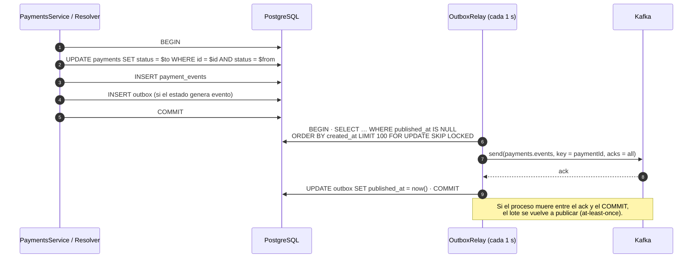
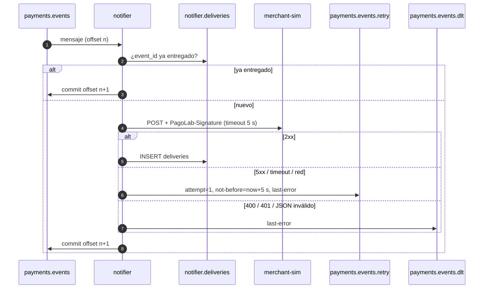

# Diseño · Fase 2 · Eventos con Kafka

Requisitos: [`requirements.md`](requirements.md) (R11–R22) · Contrato de eventos: [`asyncapi.yaml`](asyncapi.yaml) · Plan: [`tasks.md`](tasks.md)

---

## 1. Contexto y alcance

En la Fase 1, el estado de un pago solo se conoce si alguien lo consulta. La Fase 2 hace que **cada cambio relevante de estado se publique como un evento confiable**, para que sistemas independientes reaccionen sin acoplarse a `payments-api`:

- **Comercios:** reciben un webhook firmado (`notifier` → `merchant-sim`).
- **Contabilidad:** mantiene los saldos aprobados por comercio (`ledger`).

**Objetivos de diseño**

1. Ningún cambio de estado sin su evento, y ningún evento de un cambio que no ocurrió (atomicidad).
2. Ningún evento perdido aunque Kafka, un consumidor o el comercio estén caídos.
3. Los duplicados, que son inevitables, no producen efectos duplicados.
4. Un mensaje problemático no detiene a los demás.

Antes de los eventos, la fase corrige la limitación heredada de la Fase 1: las claves de idempotencia huérfanas (R11).

**Fuera de alcance:** consultar la lista en [`requirements.md`](requirements.md#fuera-de-alcance).

---

## 2. Arquitectura

```mermaid
flowchart LR
  subgraph API[payments-api]
    TX[transition&#40;&#41;<br/>misma transacción] --> P[(payments<br/>payment_events)]
    TX --> O[(outbox)]
    R[OutboxRelay<br/>1 instancia]
  end

  R -->|"SELECT … FOR UPDATE SKIP LOCKED"| O
  R -->|"key = paymentId<br/>idempotente, acks=all"| K[[payments.events<br/>6 particiones]]

  K --> N[notifier<br/>group: notifier]
  K --> L[ledger<br/>group: ledger]

  N -->|"POST firmado HMAC"| M[merchant-sim]
  N -->|reintentable| RT[[payments.events.retry]]
  N -->|no reintentable| D[[payments.events.dlt]]
  RT --> NR[notifier-retry<br/>group: notifier-retry]
  NR -->|POST firmado| M
  NR -->|agotó intentos| D
  D -.->|"npm run dlt:replay"| K

  N --> ND[(notifier.deliveries)]
  NR --> ND
  L --> LB[(ledger.processed_events<br/>ledger.merchant_balances)]
```



### Componentes

| Componente | Tipo | Responsabilidad | Consume | Produce | Persiste en |
|---|---|---|---|---|---|
| `payments-api` | NestJS (existente) | Cambios de estado y registro en outbox | — | — | `public.*` |
| `OutboxRelay` | Proceso dentro de `payments-api` | Publicar el outbox en Kafka | `outbox` | `payments.events` | `outbox.published_at` |
| `notifier` | Servicio Node/TS nuevo (`apps/notifier`) | Entregar webhooks firmados | `payments.events`, `payments.events.retry` | `…retry`, `…dlt` | `notifier.deliveries` |
| `ledger` | Servicio Node/TS nuevo (`apps/ledger`) | Saldos aprobados por comercio | `payments.events` | — | `ledger.*` |
| `merchant-sim` | Express (`apps/merchant-sim`) | Comercio simulado que verifica firmas | HTTP | — | Memoria |
| `kafka` / `kafka-init` / `kafka-ui` | Infraestructura | Broker KRaft, creación de topics, inspección | — | — | Volumen `kafkadata` |

### Puertos nuevos

| Servicio | Puerto local |
|---|---|
| Kafka (desde la máquina anfitriona) | `29092` |
| Kafka UI | `8081` |
| merchant-sim | `4100` |
| ElasticMQ / UI (perfil `sqs`, T23) | `9324` / `9325` |

`notifier` y `ledger` no publican puertos, para que puedan escalarse a varias réplicas (T22).

---

## 3. Topología de Kafka

| Topic | Particiones | Retención | Clave | Productor | Consumer groups |
|---|---|---|---|---|---|
| `payments.events` | 6 | 7 días | `paymentId` | `OutboxRelay` | `notifier`, `ledger` |
| `payments.events.retry` | 3 | Por defecto (7 días) | `paymentId` | `notifier` | `notifier-retry` |
| `payments.events.dlt` | 1 | 30 días | `paymentId` | `notifier` | `dlt-replay` (manual) |

**Criterios**

- **6 particiones en el topic principal:** el número de particiones es el techo de paralelismo por grupo. 6 permite escalar el notifier hasta 6 réplicas, y dividir entre 2 y 3 réplicas reparte la carga de forma equilibrada. Aumentar particiones después cambia la asignación de claves a particiones, así que conviene decidirlo desde el principio.
- **Retención mayor en el DLT:** un mensaje fallido necesita tiempo para diagnosticarse y reprocesarse.
- **`replication.factor = 1`:** hay un solo broker. En producción serían 3 réplicas con `min.insync.replicas = 2`, para que `acks=all` tolere la caída de un broker.
- **`auto.create.topics.enable = false`:** un nombre de topic mal escrito falla en lugar de crear un topic fantasma.
- **Dos listeners:** Kafka anuncia a cada cliente la dirección por la que debe reconectarse. Los contenedores usan `kafka:9092` y la máquina anfitriona `localhost:29092`.

---

## 4. Modelo de datos

### 4.1 Cambios en `public` (payments-api)

| Objeto | Definición | Motivo |
|---|---|---|
| `payments.idempotency_key` | `text`, nulo para pagos anteriores | Liga el pago a la clave con que se creó; permite recuperarlo (R11) |
| `ux_payments_merchant_idem` | `UNIQUE (merchant_id, idempotency_key) WHERE idempotency_key IS NOT NULL` | Segunda barrera contra duplicados, en la base de datos y no solo en la aplicación. Es parcial para no indexar los pagos históricos sin clave |
| `idempotency_keys.locked_until` | `timestamptz NOT NULL DEFAULT now() + 60 s` | Separa "en proceso" de "huérfana": pasado este instante se asume que el proceso original murió |
| `outbox` | `id uuid PK` (= `eventId`), `aggregate_id uuid`, `event_type text`, `payload jsonb`, `created_at`, `published_at` | Registro transaccional de eventos (R12) |
| `idx_outbox_unpublished` | `(created_at) WHERE published_at IS NULL` | El relay solo busca los pendientes. Al ser parcial, el índice se mantiene pequeño aunque el outbox acumule días de eventos publicados |

### 4.2 Schema `notifier`

| Tabla | Columnas | Motivo |
|---|---|---|
| `notifier.deliveries` | `event_id uuid PK`, `payment_id uuid`, `delivered_at` | Registro de entregas exitosas: evita reenviar tras un reinicio o un rebalanceo |

### 4.3 Schema `ledger`

| Tabla | Columnas | Motivo |
|---|---|---|
| `ledger.processed_events` | `event_id uuid PK`, `processed_at` | Marca de procesado. Su PK hace atómica la deduplicación |
| `ledger.merchant_balances` | `merchant_id PK`, `approved_cents bigint`, `approved_count int` | Saldo acumulado. Se actualiza con `INSERT … ON CONFLICT DO UPDATE` |

**Un schema por servicio:** cada consumidor es dueño de sus datos y no lee tablas ajenas. Comparten instancia de PostgreSQL solo por economía del laboratorio; separarlos en bases distintas no requeriría cambios de código.

---

## 5. Contrato de eventos

La fuente de verdad es [`asyncapi.yaml`](asyncapi.yaml). Resumen:

```json
{
  "eventId": "0b5c6f0e-3a51-4d36-9e0e-8a2f4d3c1b7a",
  "type": "payment.approved",
  "version": 1,
  "occurredAt": "2026-10-14T15:04:05.123Z",
  "data": {
    "id": "7c1e2a9b-…",
    "merchantId": "merchant_demo",
    "amountCents": 15000,
    "currency": "COP",
    "status": "APPROVED",
    "gatewayRef": "ch_8f3a2b1c"
  }
}
```

| Estado destino | `type` |
|---|---|
| `APPROVED` | `payment.approved` |
| `DECLINED` | `payment.declined` |
| `FAILED` | `payment.failed` |
| `UNKNOWN` | `payment.unknown` |
| `PENDING`, `PROCESSING` | *(sin evento: son estados internos)* |

**Cabeceras Kafka:** `event-id` y `event-type` permiten enrutar o filtrar sin deserializar el cuerpo.

**Decisiones del contrato**

- **Evento con estado (*event-carried state*)** en lugar de solo el id: el consumidor no necesita consultar `payments-api`, y así se evita el acoplamiento temporal.
- **Datos mínimos:** solo lo que un consumidor externo necesita. `description` y `attempts` quedan fuera porque son internos.
- **Versionado desde el día 1:** las reglas de evolución están en el `info.description` del contrato. Los consumidores ignoran campos y tipos desconocidos (*tolerant reader*).
- **`eventId` = `outbox.id`:** el mismo identificador acompaña al evento desde la base de datos hasta el comercio y sirve como clave de deduplicación en cada salto.

---

## 6. Flujos

### 6.1 Cambio de estado y publicación (R12, R15)



### 6.2 Entrega de webhooks con reintentos (R16, R18)



El consumidor `notifier-retry` aplica el mismo procedimiento sobre `payments.events.retry`, pero antes espera hasta `not-before` enviando heartbeats. Si falla de nuevo, publica con `attempt + 1`. Cuando `attempt` supera 3, el mensaje va al DLT.

### 6.3 Recuperación de claves huérfanas (R11)

```text
claim = INSERT idempotency_keys … ON CONFLICT DO NOTHING
si claim tuvo éxito                        → ejecutar handler (igual que en la Fase 1)
si no:
  existing = SELECT la clave
  expiró (expires_at)                       → 422
  request_hash distinto                     → 422
  status = COMPLETED                        → replay de la respuesta guardada
  status = IN_PROGRESS y locked_until > now → 409
  status = IN_PROGRESS y locked_until ≤ now → (huérfana)
      pago = buscar por (merchant_id, idempotency_key)
      existe   → responder su estado actual (201 si final, 202 si no), replayed = true
      no existe → DELETE la clave (solo si sigue IN_PROGRESS) y reintentar el reclamo
```

- **Pago encontrado:** el proceso original alcanzó a crear el pago. Si quedó en `PROCESSING`, el resolver de la Fase 1 lo resolverá, y el cliente recibe `202` mientras tanto.
- **Pago no encontrado:** murió antes de insertar el pago, así que no hubo cobro y es seguro reintentar.
- **Varios clientes recuperando a la vez:** el `DELETE … AND status = 'IN_PROGRESS'` y el nuevo `INSERT … ON CONFLICT` garantizan que solo uno gane el reclamo. La restricción única `ux_payments_merchant_idem` es la última barrera.

---

## 7. Firma de webhooks (R16, R17)

**Formato** (estilo Stripe):

```text
PagoLab-Signature: t=1760454245,v1=5f2b…c9a1
v1 = hex( HMAC-SHA256( secreto, "<t>.<cuerpo_crudo>" ) )
```

**Verificación en el receptor**, en este orden:

1. Leer el cuerpo **crudo** (`express.raw`). Si se parsea a JSON y se vuelve a serializar, puede cambiar el orden de las claves o los espacios, y la firma deja de coincidir.
2. Rechazar con `400` si `|ahora − t| > 300 s`. La marca de tiempo forma parte de lo firmado, así que no puede alterarse sin invalidar la firma. Esto limita los ataques de repetición (*replay*) a una ventana de 5 minutos.
3. Recalcular el HMAC y comparar con `timingSafeEqual`, tras verificar que ambas longitudes coinciden. Una comparación normal (`===`) termina en el primer byte distinto, y su tiempo de respuesta revela cuántos bytes acertó un atacante. Si falla, responder `401`.
4. Deduplicar por `eventId` y responder `200` también a los duplicados. Si respondiera error, el emisor seguiría reintentando.

**Por qué HMAC:** con un secreto compartido, el comercio comprueba dos cosas: que el mensaje lo envió PagoLab (autenticidad) y que nadie lo alteró en el camino (integridad).

---

## 8. Garantías de entrega

| Salto | Garantía | Mecanismo | Qué pasa si algo muere a mitad |
|---|---|---|---|
| Cambio de estado → outbox | **Atómica** | Misma transacción PostgreSQL | No queda ni el cambio ni el evento |
| Outbox → Kafka | **Al menos una vez** | `published_at` se marca después del ack | Lote publicado de nuevo → duplicados en Kafka con el mismo `eventId` |
| Kafka → notifier → comercio | **Al menos una vez** | Commit del offset después de procesar · `notifier.deliveries` · deduplicación en el receptor | Webhook reenviado; el receptor lo detecta como duplicado |
| Kafka → ledger | **Efecto exactamente una vez** | `processed_events` y saldo en la misma transacción | La transacción se revierte completa; el reproceso detecta el duplicado |

**La diferencia clave:** cuando el efecto es una escritura en **la misma base de datos** que la marca de procesado, ambas se confirman juntas y el efecto ocurre una sola vez. Un efecto **HTTP** no puede participar de esa transacción: siempre existe una ventana entre "el comercio recibió" y "registré que recibió". Por eso la deduplicación final la hace el receptor.

**Commit del offset `+ 1`:** el offset confirmado es la posición del **próximo** mensaje a leer, no la del último procesado. Confirmar `n` en vez de `n + 1` reprocesaría el último mensaje en cada reinicio.

---

## 9. Orden de los eventos

- **Kafka garantiza el orden solo dentro de una partición.** Con `key = paymentId`, todos los eventos de un pago caen en la misma partición y se consumen en el orden en que se publicaron.
- **El relay corre en una sola instancia:** con dos relays, el evento `payment.unknown` de un pago podría publicarse después de su `payment.approved`. `FOR UPDATE SKIP LOCKED` evita la doble publicación, pero no garantiza el orden entre instancias. En Kubernetes (Fase 6) será un `Deployment` de 1 réplica.
- **Productor idempotente con `maxInFlightRequests: 1`:** los reintentos internos del productor no duplican ni reordenan mensajes dentro de la partición.
- **Los reintentos rompen el orden estricto por pago:** si el webhook de `payment.unknown` entra a reintento, el de `payment.approved` puede llegar antes. Mitigación adoptada: el contrato incluye `occurredAt` y el receptor ignora los eventos más antiguos que el último que procesó para ese pago. Alternativa descartada por ahora: bloquear la clave mientras tenga un reintento pendiente. Preserva el orden, pero agrega estado y reintroduce bloqueo.

---

## 10. Clasificación de errores

| Error | Ejemplo | ¿Reintentable? | Destino |
|---|---|---|---|
| Respuesta `5xx` del comercio | `500` simulado (`FAIL_RATE`) | Sí | `payments.events.retry` |
| Timeout o error de red | Comercio caído o lento (> 5 s) | Sí | `payments.events.retry` |
| Firma rechazada | `401` | No | `payments.events.dlt` |
| Petición rechazada | `400` (p. ej., reloj desfasado) | No | `payments.events.dlt` |
| Mensaje no deserializable | Texto no JSON (`SyntaxError`) | No | `payments.events.dlt` |
| Reintentos agotados | 4.º fallo consecutivo | — | `payments.events.dlt` |

**Por qué un topic de reintento y no reintentar en el mismo lugar:** reintentar dentro de `eachMessage` con esperas de 2 minutos bloquearía toda la partición, y con ella los eventos de muchos otros pagos (*head-of-line blocking*). Al derivar el mensaje fallido, la partición principal sigue avanzando.

---

## 11. Operación

### Configuración

| Variable | Servicio | Valor en Compose | Descripción |
|---|---|---|---|
| `KAFKA_BROKERS` | payments-api, notifier, ledger | `kafka:9092` | Lista de brokers separada por comas |
| `RELAY_ENABLED` | payments-api | `true` | Activa el relay (solo en una instancia) |
| `DATABASE_URL` | notifier, ledger | `postgres://…@postgres:5432/pagolab` | Conexión a PostgreSQL |
| `MERCHANT_WEBHOOK_URL` | notifier | `http://merchant-sim:4100/webhooks/pagolab` | Destino de los webhooks |
| `WEBHOOK_SECRET` | notifier, merchant-sim | `whsec_local` | Secreto HMAC compartido |
| `FAIL_RATE` | merchant-sim | `0.2` | Proporción de `500` simulados |

### Procedimientos

| Situación | Procedimiento |
|---|---|
| Ver eventos y lag | Kafka UI → *Topics* / *Consumers* (http://localhost:8081) |
| Kafka caído | Ninguna acción: el outbox acumula y el relay publica al volver (R15) |
| Mensajes en el DLT | Diagnosticar `last-error`, corregir la causa, ejecutar `npm run dlt:replay` en `apps/notifier` |
| Reconstruir el ledger | Detener `ledger`, vaciar sus tablas, `kafka-consumer-groups.sh --reset-offsets --to-earliest --group ledger --execute` y levantarlo |
| Crecimiento del outbox | Tarea diaria que elimina los eventos publicados hace más de 7 días |
| Apagado | `SIGTERM`: los consumidores salen del grupo de forma ordenada, lo que acelera el rebalanceo de los demás (R21) |

---

## 12. Estrategia de pruebas

| Componente | Tipo | Casos clave |
|---|---|---|
| Recuperación de claves (R11) | Integración (Testcontainers) | Clave huérfana con pago → mismo pago sin volver a cobrar · huérfana sin pago → se procesa como nueva · bloqueo vigente → `409` · dos pagos con la misma clave → la BD lo rechaza |
| Outbox (R12) | Integración | Pago aprobado → exactamente 1 evento · `UNKNOWN → APPROVED` → 2 eventos en orden · fallo después del `UPDATE` → ni cambio ni evento |
| `buildPaymentEvent` (R13) | Unitaria | Mapeo estado → tipo · `PENDING`/`PROCESSING` → `null` · forma conforme al contrato |
| Relay (R15) | Integración (Testcontainers con Kafka, o productor falso) | Publica con la clave correcta y marca `published_at` · si `send` falla, no marca nada · lote vacío → 0 |
| Firma (R16) | Unitaria | Firma determinista con un `now` fijo · el receptor acepta la propia firma |
| Clasificación de errores (R18) | Unitaria | Reintentable → retry con backoff correcto · intento 4 → DLT · no reintentable → DLT directo · se conserva la clave |
| Ledger (R19) | Integración | Aplica una vez · duplicado → sin cambios · tipo distinto → ignorado · saldos = suma de aprobados |
| Receptor (R17) | Manual (`curl`) | Firma válida `200` · cuerpo alterado `401` · `t` de hace 10 min `400` · duplicado |
| Topología y grupos (R14, R20) | Laboratorio | [`kafka-lab.md`](kafka-lab.md) |

---

## 13. Decisiones y trade-offs

| # | Decisión | Alternativas | Motivo |
|---|---|---|---|
| D1 | **Transactional outbox** | Escritura doble (BD + Kafka) · CDC con Debezium | La escritura doble no es atómica: si Kafka falla después del `COMMIT`, el evento se pierde. CDC es robusto pero agrega infraestructura (Kafka Connect); el outbox resuelve lo mismo con una tabla |
| D2 | **Llamada a Kafka dentro de la transacción del relay** | Marcar antes de enviar · enviar fuera de la transacción | Simplifica el código y mantiene el bloqueo `SKIP LOCKED` mientras se publica. Es aceptable porque Kafka es local y rápido. En la Fase 1 se evitó con la pasarela porque es lenta y externa |
| D3 | **Relay en una sola instancia** | Varias instancias con particionamiento del outbox | Preserva el orden por pago sin coordinación adicional. El throughput de un relay basta para el volumen esperado |
| D4 | **Al menos una vez + consumidores idempotentes** | Exactly-once con transacciones de Kafka | Las transacciones de Kafka solo cubren consumir-transformar-producir dentro de Kafka. No cubren un webhook ni una BD externa |
| D5 | **Topic de reintento con backoff + DLT** | Reintento en el lugar · cola de reintentos en BD | Evita el bloqueo de la partición y hace visibles y reprocesables los fallos |
| D6 | **HMAC-SHA256 con marca de tiempo** | mTLS · JWT firmado | Estándar de la industria para webhooks (Stripe, GitHub). Fácil de implementar en el receptor, sin gestionar certificados |
| D7 | **KafkaJS** | `@confluentinc/kafka-javascript` | API más clara para aprender. KafkaJS está prácticamente sin mantenimiento; en producción se evaluaría el cliente de Confluent, que tiene una API compatible |
| D8 | **Kafka 3.9 en KRaft** | Kafka 4.x · ZooKeeper | KRaft elimina ZooKeeper. Kafka 4 retiró protocolos que KafkaJS aún usa |
| D9 | **Schema por servicio en una sola instancia** | Una base por servicio | Aislamiento lógico con costo cero en el laboratorio. Migrar a bases separadas no cambia el código |
| D10 | **Eventos con estado completo** | Solo el id (*notificación*) | Los consumidores no dependen de que `payments-api` esté disponible |

---

## 14. Limitaciones conocidas

- **Un solo comercio y un solo secreto:** no hay registro de comercios con su URL y secreto, ni rotación de secretos. Para la rotación, el formato admite varias firmas `v1` durante una transición, pero aún no se implementa.
- **Orden no estricto tras reintentos:** mitigado con `occurredAt` del lado del receptor (§ 9).
- **`merchant-sim` deduplica en memoria:** pierde su registro al reiniciarse; un receptor real lo persistiría.
- **Relay sin alta disponibilidad:** si su única instancia cae, los eventos esperan en el outbox hasta que vuelva. No se pierden, pero se retrasan. Esto se mejorará con *leader election* en Kubernetes.
- **Broker único:** sin tolerancia a fallos de Kafka (`replication.factor = 1`).
