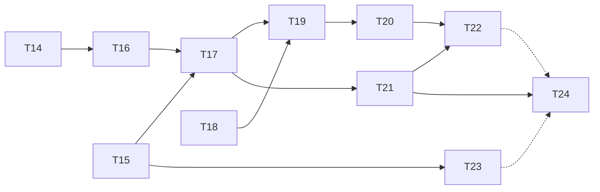

# Plan de implementación · Fase 2

Requisitos: [`requirements.md`](requirements.md) · Diseño: [`design.md`](design.md) · Contrato: [`asyncapi.yaml`](asyncapi.yaml)

**Modalidad:** el código de producción lo escribes a mano, siguiendo la guía del laboratorio. Este plan indica, por ticket, qué requisitos cumple, qué entregar y cómo verificarlo. Las pruebas y la documentación pueden apoyarse en Claude.

**Convenciones:** una rama por ticket (`gianca/tNN`), un commit con el mensaje indicado y un PR hacia `develop`. Al cerrar la fase, `develop` se integra en `main` con un PR de release.

---

## Antes de empezar: ajustes del código de la guía a este repositorio

El repositorio usa **ESM con `module: nodenext`** y **Vitest con Testcontainers**. Algunos fragmentos de la guía necesitan estos ajustes:

| # | Dónde | Ajuste |
|---|---|---|
| A1 | `payment-events.ts`, `outbox-relay.ts` (T16–T17) | Las importaciones relativas llevan extensión `.js`: `'./payment.js'`, `'../common/transaction.js'`, `'./kafka.module.js'`. Sin ella, `tsc` falla con `nodenext` |
| A2 | `test/support/app.ts` (T17) | Con `KafkaModule`, la app intenta conectarse a Kafka al iniciar y **todas las pruebas e2e fallarían**. En `createTestApp`, sobrescribe el proveedor `KAFKA_PRODUCER` con un productor falso (`connect`, `send` y `disconnect` como `vitest.fn()`), y define `RELAY_ENABLED=false` y `KAFKA_BROKERS` |
| A3 | Pruebas del relay (T17) | El productor falso de A2 permite verificar la clave, las cabeceras y que `published_at` solo se marca si `send` tuvo éxito. Una prueba con Kafka real (`@testcontainers/kafka`) es opcional |
| A4 | `docker-compose.yml` (T17) | Agrega `KAFKA_BROKERS` y `RELAY_ENABLED` al servicio `payments-api` y haz que dependa de `kafka-init` (`service_completed_successfully`) |
| A5 | `infra/kafka/create-topics.sh` (T15) | El `.gitattributes` ya fuerza LF. Si el archivo se creó antes con CRLF, `sh` falla con `\r: not found`: ejecuta `git add --renormalize .` |
| A6 | `vitest.config.ts` | Los servicios nuevos (`apps/notifier`, `apps/ledger`) tienen su propio `package.json` y sus propias pruebas; la cobertura ≥ 85 % de R22 aplica a `payments-api` |
| A7 | Git Bash | Para enviar un archivo a un contenedor, usa `docker compose exec -T … < archivo`. Las rutas como `/tmp/x` se traducen a rutas de Windows (`MSYS_NO_PATHCONV=1` lo evita) |
| A8 | `apps/merchant-sim/src/server.js` (T18) | Envuelve `JSON.parse` en `try/catch` y responde `400`. Sin eso, un cuerpo no JSON con firma válida produce un `500` de Express, que el notifier reintentaría (R17, design § 7) |
| A9 | `docker-compose.yml` (T18) | Declara `FAIL_RATE: ${FAIL_RATE:-0.2}` en lugar de un valor fijo. Así T18–T20 cambian la tasa sin editar el archivo: `FAIL_RATE=0 docker compose up -d merchant-sim`. Agrega también `init: true`, como en `gateway-sim` |
| A10 | `apps/notifier/package.json` (T19) | Instala `typescript@~6.0`, como `payments-api`. Sin versión, npm instala TypeScript 7 |
| A11 | `apps/notifier/tsconfig.json` (T19) | Escríbelo a mano (`nodenext`, `ES2022`, `strict`, `rootDir: src`, `include: ["src"]`, `types: ["node"]`) en lugar de usar `tsc --init`. Así las pruebas de `test/` quedan fuera del build |
| A12 | `apps/notifier/src/deliver.ts` (T19) | Declara la interfaz `PaymentEvent` con solo los campos que se usan (*tolerant reader*) en lugar de `any` |
| A13 | `apps/notifier/.dockerignore` (T19) | Excluye `node_modules`, `dist` y `test`. Sin él, `COPY . .` copia el `node_modules` de Windows sobre el de Linux |
| A14 | `docker-compose.yml` (T19) | `notifier` depende también de `merchant-sim` (`service_started`) |
| A15 | `apps/notifier/src/deliver.ts` (T20) | `parseEvent` convierte cualquier mensaje inservible (no JSON, `null`, sin `eventId` UUID o sin `data.id`) en `NonRetryableError`. Así la regla es "todo lo que no sea `NonRetryableError` se reintenta", y un JSON válido pero incompleto no consume 3 reintentos inútiles |
| A16 | `apps/notifier/src/retry.ts` (T20) | `sendToRetryOrDlt` copia las cabeceras originales (`...msg.headers`) antes de escribir las de reintento. La guía las armaba desde cero y perdía `event-id` y `event-type` |
| A17 | `apps/notifier/src/main.ts` (T20) | Una función `handle()` común entrega o deriva el mensaje en ambos consumidores: una sola regla de clasificación, sin código duplicado |
| A18 | `apps/notifier/src/main.ts` (T20) | Bandera `stopping` en la espera de `notifier-retry`: ante `SIGTERM` sale sin hacer commit, en lugar de esperar hasta 120 s y terminar con `SIGKILL` |
| A19 | `apps/notifier/src/main.ts` (T20) | `fromBeginning: true` en `notifier-retry`, para que el grupo, al crearse, no se salte mensajes ya derivados |
| A20 | `apps/notifier/src/dlt-replay.ts` (T20) | La guía no trae código. Antes de consumir, el script toma una foto de los offsets del DLT (`fetchTopicOffsets`) y de los del grupo (`fetchOffsets`), y termina al alcanzarla. Sin la foto, un consumidor de Kafka nunca sabe que "se acabó" |
| A21 | Build del notifier | Vitest no verifica tipos. Ejecuta `npm test && npx tsc --noEmit`: si `tsc` falla, el build de Docker también falla y Compose **sigue corriendo la imagen anterior** sin avisar |
| A22 | Migración `create_ledger_schema` (T21) | `merchant_balances` con PK `(merchant_id, currency)`, `approved_cents bigint` y `CHECK ≥ 0`. La guía sumaba COP y USD en una sola cifra |
| A23 | `apps/ledger/src/main.ts` (T21) | `parseEvent` + `InvalidEventError`: un mensaje inválido se registra y se salta. Sin esto, el mensaje venenoso de T20 bloquea el ledger en su primer arranque. Un error de base de datos se relanza para no saltarse pagos reales |
| A24 | Verificación de T21 | El seed de T12 tiene unos 250 000 pagos aprobados sin evento: se comparan solo los que tienen `payment.approved` en el outbox, con una consulta de diferencias (`FULL JOIN` + `IS DISTINCT FROM`) |
| A25 | `specs/fase-2/kafka-lab.md`, `sqs-lab.md` | Son plantillas de laboratorio locales: se excluyen en `.git/info/exclude` y no se versionan |
| A26 | Cierre de la fase (T24) | T22 y T23 son laboratorios de estudio sin código de producción: quedan como ejercicios locales y **no bloquean** el cierre. T23 se pospone; su código (`infra/elasticmq`, `labs/sqs`) se agregará cuando se realice |

---

## Tickets

### T14 · Recuperación de claves huérfanas
- **Requisitos:** R11, R22
- **Entregables:**
  - Migración `idempotency_recovery`: `payments.idempotency_key`, `ux_payments_merchant_idem` e `idempotency_keys.locked_until`.
  - `PaymentsRepository.insert` guarda la clave y se agrega `findByIdempotencyKey`.
  - `PaymentsService.createAndCharge` recibe la clave y se agrega `findByIdempotencyKey`.
  - `IdempotencyService.execute` recibe el parámetro `recover` y trata la clave `IN_PROGRESS` vencida.
  - `PaymentsController` pasa `recover`, usando `isFinal` de `payment-status.ts`.
- **Verificación:**
  - [x] Clave huérfana con pago → devuelve el mismo pago, `Idempotent-Replayed: true` y la pasarela no vuelve a cobrar.
  - [x] Clave huérfana sin pago → se procesa como nueva.
  - [x] Insertar dos pagos con la misma (`merchant_id`, `idempotency_key`) falla en la BD.
  - [x] `npm run test:cov` en verde y ≥ 85 %.
- **Commit:** `fix: recuperacion de claves de idempotencia huerfanas`

### T15 · Kafka KRaft, Kafka UI y topics
- **Requisitos:** R14
- **Entregables:** servicios `kafka`, `kafka-init` y `kafka-ui` en Compose; volumen `kafkadata`; script `infra/kafka/create-topics.sh`.
- **Verificación:**
  - [x] `kafka` en estado *healthy* y los 3 topics visibles en http://localhost:8081.
  - [x] `--describe` muestra 6 / 3 / 1 particiones.
  - [x] Experimento: misma clave → misma partición → mismo orden.
  - [x] Topic de pruebas limpiado (borrado y recreado).
- **Commit:** `chore: kafka kraft, kafka-ui y creacion de topics`

### T16 · Transactional outbox
- **Requisitos:** R12, R13
- **Entregables:**
  - Migración `create_outbox` con `idx_outbox_unpublished`.
  - `src/payments/domain/payment-events.ts` con `buildPaymentEvent`.
  - Inserción en `outbox` dentro de `PaymentsRepository.transition`.
- **Verificación:**
  - [x] Pago aprobado → exactamente 1 fila con `event_type = 'payment.approved'`.
  - [x] `UNKNOWN → APPROVED` → 2 eventos, en orden.
  - [x] Fallo simulado después del `UPDATE` → ni cambio ni evento.
  - [x] El `payload` cumple el esquema `PaymentEvent` de `asyncapi.yaml`.
- **Commit:** `feat: transactional outbox para eventos de pagos`

### T17 · Outbox relay hacia Kafka
- **Requisitos:** R13, R15, R21
- **Entregables:**
  - `kafkajs`.
  - `src/messaging/kafka.module.ts` y `src/messaging/outbox-relay.ts`.
  - `MessagingModule`.
  - Limpieza diaria del outbox.
  - Variables en `.env`, `.env.example` y Compose.
  - Ajustes A1–A4.
- **Verificación:**
  - [x] 10 pagos creados → 10 mensajes en Kafka UI con clave = id del pago y cabeceras `event-id` y `event-type`.
  - [x] `docker compose stop kafka`, crear pagos, levantar Kafka → los eventos pendientes se publican solos.
  - [x] Pruebas del relay en verde; cobertura ≥ 85 %.
- **Commit:** `feat: outbox relay hacia kafka con productor idempotente`

### T18 · Comercio simulado con verificación HMAC
- **Requisitos:** R17
- **Entregables:** `apps/merchant-sim` (Express, ESM), su Dockerfile y el servicio en Compose (puerto `4100`, `WEBHOOK_SECRET`, `FAIL_RATE`). Ajustes A8 y A9.
- **Verificación** (con `FAIL_RATE=0`):
  - [x] Firma válida → `200`.
  - [x] Cuerpo alterado → `401`.
  - [x] `t` alterado sin volver a firmar → `401`.
  - [x] `t` de hace 10 minutos → `400`.
  - [x] Sin cabecera de firma → `400`.
  - [x] Cuerpo no JSON con firma válida → `400`.
  - [x] El mismo `eventId` dos veces → duplicado.
  - [x] Con `FAIL_RATE=0.2`, alrededor del 20 % de los webhooks válidos responde `500`.
- **Commit:** `feat: comercio simulado con verificacion hmac de webhooks`

### T19 · Notifier con commits manuales y entrega idempotente
- **Requisitos:** R16, R20, R21
- **Entregables:**
  - Migración `create_notifier_schema`.
  - Proyecto `apps/notifier` (TypeScript, ESM) con `signing.ts`, `deliver.ts` y `main.ts`.
  - Dockerfile multi-stage y servicio en Compose sin puertos.
- **Verificación:**
  - [x] Con `FAIL_RATE: "0"`, cada pago aprobado, rechazado, fallido o desconocido (`payment.unknown`) genera un webhook verificado en los logs de `merchant-sim`.
  - [x] Reiniciar el notifier no reenvía lo ya entregado.
  - [x] Pruebas unitarias de `signWebhook` y de `deliver` (añadidas en el cierre de la fase).
- **Commit:** `feat: notifier con commits manuales y entrega idempotente`

### T20 · Retry topic con backoff y DLT
- **Requisitos:** R18
- **Entregables:** `src/retry.ts`; manejo de errores en el consumidor principal; consumidor `notifier-retry`; script `dlt:replay`.
- **Verificación:**
  - [x] `FAIL_RATE: "0.5"` → todos se entregan, con reintentos visibles en los logs.
  - [x] `FAIL_RATE: "1"` → los mensajes terminan en el DLT con `last-error`.
  - [x] Mensaje no JSON producido a mano → DLT directo, sin bloquear la partición.
  - [x] `dlt:replay` reprocesa el DLT tras volver `FAIL_RATE` a 0.
  - [x] Pruebas unitarias de `sendToRetryOrDlt` (backoff, intento 4 → DLT, no reintentable → DLT, clave conservada).
- **Commit:** `feat: retry topic con backoff y dead letter topic`

### T21 · Ledger con efecto exactamente una vez
- **Requisitos:** R19, R20
- **Entregables:** migración `create_ledger_schema`; servicio `apps/ledger` (decisión D12 en `design.md`); servicio en Compose. Ajustes A22–A24.
- **Verificación:**
  - [x] La consulta de diferencias devuelve `0 rows`. Compara solo los pagos aprobados **con evento**: los del seed de la Fase 1 nunca se publicaron (A24).
    ```sql
    WITH esperado AS (
      SELECT p.merchant_id, p.currency, sum(p.amount_cents) AS cents, count(*) AS n
        FROM payments p
       WHERE p.status = 'APPROVED'
         AND EXISTS (SELECT 1 FROM outbox o
                      WHERE o.aggregate_id = p.id AND o.event_type = 'payment.approved')
       GROUP BY 1, 2
    )
    SELECT merchant_id, currency, e.cents, b.approved_cents, e.n, b.approved_count
      FROM esperado e
      FULL JOIN ledger.merchant_balances b USING (merchant_id, currency)
     WHERE e.cents IS DISTINCT FROM b.approved_cents
        OR e.n     IS DISTINCT FROM b.approved_count;
    ```
  - [x] Tras vaciar las tablas y reiniciar los offsets del grupo `ledger` al inicio, la consulta sigue en `0 rows`.
  - [x] Con el notifier detenido, el ledger sigue aplicando pagos nuevos (R20).
  - [x] Pruebas de `apply`: aplica una vez, ignora duplicados, ignora otros tipos, concurrencia y todo o nada.
- **Commit:** `feat: consumidor ledger con efecto exactamente una vez en base de datos`

### T22 · Laboratorio de consumer groups
- **Requisitos:** R20 (evidencia)
- **Entregables:** `kafka-lab.md` (local, no versionado, A25) completo con los 9 experimentos y capturas.
- **Estado:** laboratorio local de estudio, sin commit (A26).

### T23 · Laboratorio SQS con ElasticMQ
- **Requisitos:** — (comparativa conceptual)
- **Entregables:** `infra/elasticmq/elasticmq.conf`, servicio con perfil `sqs`, `labs/sqs/lab.ts` y `sqs-lab.md` (local, no versionado, A25) completo.
- **Estado:** pospuesto (A26).
- **Commit (cuando se realice):** `docs: laboratorio sqs con elasticmq y comparacion con kafka`

### T24 · Cierre de la fase
- **Entregables:**
  - [x] Revisar estos specs contra lo implementado. Si algo cambió, actualizar el spec: es documentación viva.
  - [x] README: arquitectura de la fase 2, servicios nuevos y cómo ver los eventos en Kafka UI.
  - [ ] Autoevaluación sin mirar (local, no versionada): P5.1–P5.5, orden en Kafka, visibility timeout, P14.2 y P14.4.
  - [x] Preparación open source: licencia MIT, secciones *Contribuir* y *Licencia*, `.env.example` con valores locales y artefactos de build fuera del repositorio.
- **Commit:** `docs: cierre de la fase 2`

---

## Orden y dependencias



T14 y T15 son independientes entre sí y pueden hacerse en cualquier orden. Las líneas punteadas hacia T24 son laboratorios opcionales (A26).
