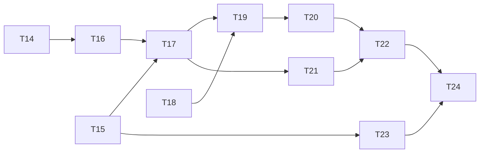

# Plan de implementación · Fase 2

Requisitos: [`requirements.md`](requirements.md) · Diseño: [`design.md`](design.md) · Contrato: [`asyncapi.yaml`](asyncapi.yaml)

**Modalidad:** el código de producción lo escribes a mano, siguiendo la guía del laboratorio. Este plan indica, por ticket, qué requisitos cumple, qué entregar y cómo verificarlo. Las pruebas y la documentación pueden apoyarse en Claude.

**Convenciones:** una rama por ticket (`gianca/tNN`), un commit con el mensaje indicado y un PR hacia `main`.

---

## Antes de empezar: ajustes del código de la guía a este repositorio

El repositorio usa **ESM con `module: nodenext`** y **Vitest con Testcontainers**. Algunos fragmentos de la guía necesitan estos ajustes:

| # | Dónde | Ajuste |
|---|---|---|
| A1 | `payment-events.ts`, `outbox-relay.ts` (T16–T17) | Las importaciones relativas llevan extensión `.js`: `'./payment.js'`, `'../common/transaction.js'`, `'./kafka.module.js'`. Sin ella, `tsc` falla con `nodenext` |
| A2 | `test/support/app.ts` (T17) | Con `KafkaModule`, la app intenta conectarse a Kafka al iniciar y **todas las pruebas e2e fallarían**. En `createTestApp`, sobrescribe el proveedor `KAFKA_PRODUCER` con un productor falso (`connect`, `send` y `disconnect` como `vitest.fn()`), y define `RELAY_ENABLED=false` y `KAFKA_BROKERS` |
| A3 | Pruebas del relay (T17) | El productor falso de A2 permite verificar la clave, las cabeceras y que `published_at` solo se marca si `send` tuvo éxito. Una prueba con Kafka real (`@testcontainers/kafka`) es opcional |
| A4 | `docker-compose.yml` (T17) | Agrega `KAFKA_BROKERS` y `RELAY_ENABLED` al servicio `payments-api` y haz que dependa de `kafka-init` (`service_completed_successfully`) |
| A5 | `infra/kafka/create-topics.sh` (T15) | El `.gitattributes` ya fuerza LF. Si el archivo se creó antes con CRLF, `sh` falla con `\r: not found`: ejecuta `git add --renormalize .` |
| A6 | `vitest.config.ts` | Los servicios nuevos (`apps/notifier`, `apps/ledger`) tienen su propio `package.json` y sus propias pruebas; la cobertura ≥ 85 % de R22 aplica a `payments-api` |
| A7 | Git Bash | Para enviar un archivo a un contenedor, usa `docker compose exec -T … < archivo`. Las rutas como `/tmp/x` se traducen a rutas de Windows (`MSYS_NO_PATHCONV=1` lo evita) |

---

## Tickets

### T14 · Recuperación de claves huérfanas
- **Requisitos:** R11, R22
- **Entregables:**
  - Migración `idempotency_recovery`: `payments.idempotency_key`, `ux_payments_merchant_idem` e `idempotency_keys.locked_until`.
  - `PaymentsRepository.insert` guarda la clave y se agrega `findByIdempotencyKey`.
  - `PaymentsService.createAndCharge` recibe la clave y se agrega `findByIdempotencyKey`.
  - `IdempotencyService.execute` recibe el parámetro `recover` y trata la clave `IN_PROGRESS` vencida.
  - `PaymentsController` pasa `recover`, usando `isFinal` de `payment-status.ts`.
- **Verificación:**
  - [x] Clave huérfana con pago → devuelve el mismo pago, `Idempotent-Replayed: true` y la pasarela no vuelve a cobrar.
  - [x] Clave huérfana sin pago → se procesa como nueva.
  - [x] Insertar dos pagos con la misma (`merchant_id`, `idempotency_key`) falla en la BD.
  - [x] `npm run test:cov` en verde y ≥ 85 %.
- **Commit:** `fix: recuperacion de claves de idempotencia huerfanas`

### T15 · Kafka KRaft, Kafka UI y topics
- **Requisitos:** R14
- **Entregables:** servicios `kafka`, `kafka-init` y `kafka-ui` en Compose; volumen `kafkadata`; script `infra/kafka/create-topics.sh`.
- **Verificación:**
  - [x] `kafka` en estado *healthy* y los 3 topics visibles en http://localhost:8081.
  - [x] `--describe` muestra 6 / 3 / 1 particiones.
  - [x] Experimento: misma clave → misma partición → mismo orden.
  - [x] Topic de pruebas limpiado (borrado y recreado).
- **Commit:** `chore: kafka kraft, kafka-ui y creacion de topics`

### T16 · Transactional outbox
- **Requisitos:** R12, R13
- **Entregables:**
  - Migración `create_outbox` con `idx_outbox_unpublished`.
  - `src/payments/domain/payment-events.ts` con `buildPaymentEvent`.
  - Inserción en `outbox` dentro de `PaymentsRepository.transition`.
- **Verificación:**
  - [x] Pago aprobado → exactamente 1 fila con `event_type = 'payment.approved'`.
  - [x] `UNKNOWN → APPROVED` → 2 eventos, en orden.
  - [x] Fallo simulado después del `UPDATE` → ni cambio ni evento.
  - [x] El `payload` cumple el esquema `PaymentEvent` de `asyncapi.yaml`.
- **Commit:** `feat: transactional outbox para eventos de pagos`

### T17 · Outbox relay hacia Kafka
- **Requisitos:** R13, R15, R21
- **Entregables:**
  - `kafkajs`.
  - `src/messaging/kafka.module.ts` y `src/messaging/outbox-relay.ts`.
  - `MessagingModule`.
  - Limpieza diaria del outbox.
  - Variables en `.env`, `.env.example` y Compose.
  - Ajustes A1–A4.
- **Verificación:**
  - [x] 10 pagos creados → 10 mensajes en Kafka UI con clave = id del pago y cabeceras `event-id` y `event-type`.
  - [x] `docker compose stop kafka`, crear pagos, levantar Kafka → los eventos pendientes se publican solos.
  - [x] Pruebas del relay en verde; cobertura ≥ 85 %.
- **Commit:** `feat: outbox relay hacia kafka con productor idempotente`

### T18 · Comercio simulado con verificación HMAC
- **Requisitos:** R17
- **Entregables:** `apps/merchant-sim` (Express, ESM), su Dockerfile y el servicio en Compose (puerto `4100`, `WEBHOOK_SECRET`, `FAIL_RATE`).
- **Verificación:**
  - [ ] Firma válida → `200`.
  - [ ] Cuerpo alterado → `401`.
  - [ ] `t` de hace 10 minutos → `400`.
  - [ ] El mismo `eventId` dos veces → duplicado.
- **Commit:** `feat: comercio simulado con verificacion hmac de webhooks`

### T19 · Notifier con commits manuales y entrega idempotente
- **Requisitos:** R16, R20, R21
- **Entregables:**
  - Migración `create_notifier_schema`.
  - Proyecto `apps/notifier` (TypeScript, ESM) con `signing.ts`, `deliver.ts` y `main.ts`.
  - Dockerfile multi-stage y servicio en Compose sin puertos.
- **Verificación:**
  - [ ] Con `FAIL_RATE: "0"`, cada pago aprobado, rechazado o fallido genera un webhook verificado en los logs de `merchant-sim`.
  - [ ] Reiniciar el notifier no reenvía lo ya entregado.
  - [ ] Pruebas unitarias de `signWebhook`.
- **Commit:** `feat: notifier con commits manuales y entrega idempotente`

### T20 · Retry topic con backoff y DLT
- **Requisitos:** R18
- **Entregables:** `src/retry.ts`; manejo de errores en el consumidor principal; consumidor `notifier-retry`; script `dlt:replay`.
- **Verificación:**
  - [ ] `FAIL_RATE: "0.5"` → todos se entregan, con reintentos visibles en los logs.
  - [ ] `FAIL_RATE: "1"` → los mensajes terminan en el DLT con `last-error`.
  - [ ] Mensaje no JSON producido a mano → DLT directo, sin bloquear la partición.
  - [ ] `dlt:replay` reprocesa el DLT tras volver `FAIL_RATE` a 0.
  - [ ] Pruebas unitarias de `sendToRetryOrDlt` (backoff, intento 4 → DLT, no reintentable → DLT, clave conservada).
- **Commit:** `feat: retry topic con backoff y dead letter topic`

### T21 · Ledger con efecto exactamente una vez
- **Requisitos:** R19, R20
- **Entregables:** migración del schema `ledger`; servicio `apps/ledger` (o un segundo punto de entrada en `apps/notifier`; decide y anota la elección en `design.md`); servicio en Compose.
- **Verificación:**
  - [ ] Esta consulta coincide con `ledger.merchant_balances`:
    ```sql
    SELECT merchant_id, sum(amount_cents), count(*) FROM payments WHERE status = 'APPROVED' GROUP BY 1
    ```
  - [ ] Pruebas de `apply`: aplica una vez, ignora duplicados e ignora otros tipos.
- **Commit:** `feat: consumidor ledger con efecto exactamente una vez en base de datos`

### T22 · Laboratorio de consumer groups
- **Requisitos:** R20 (evidencia)
- **Entregables:** [`kafka-lab.md`](kafka-lab.md) completo con los 9 experimentos y capturas.
- **Commit:** `docs: laboratorio de consumer groups, rebalanceo, lag y replay`

### T23 · Laboratorio SQS con ElasticMQ
- **Requisitos:** — (comparativa conceptual)
- **Entregables:** `infra/elasticmq/elasticmq.conf`, servicio con perfil `sqs`, `labs/sqs/lab.ts` y [`sqs-lab.md`](sqs-lab.md) completo.
- **Commit:** `docs: laboratorio sqs con elasticmq y comparacion con kafka`

### T24 · Cierre de la fase
- **Entregables:**
  - [ ] Revisar estos specs contra lo implementado. Si algo cambió, actualizar el spec: es documentación viva.
  - [ ] README: arquitectura de la fase 2, servicios nuevos y cómo ver los eventos en Kafka UI.
  - [ ] Autoevaluación sin mirar: P5.1–P5.5, orden en Kafka, visibility timeout, P14.2 y P14.4.
- **Commit:** `docs: cierre de la fase 2`

---

## Orden y dependencias



T14 y T15 son independientes entre sí y pueden hacerse en cualquier orden.
